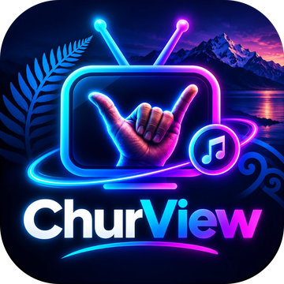
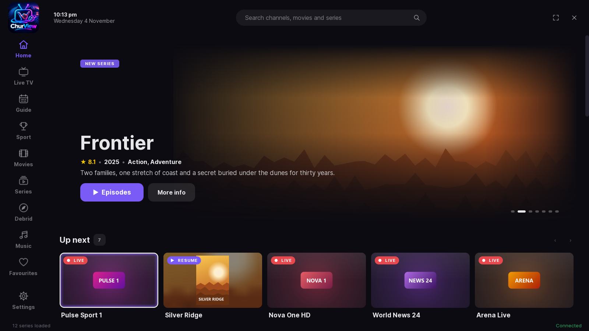
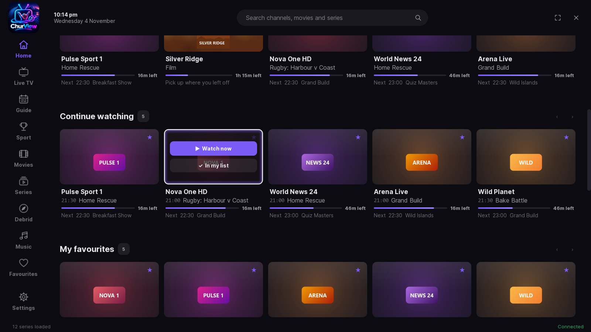
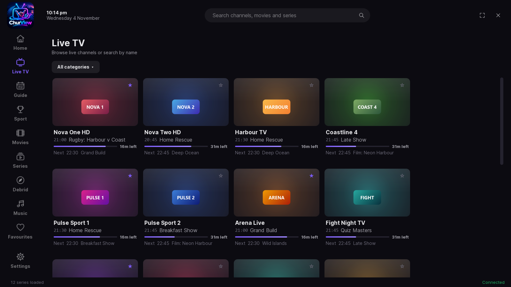
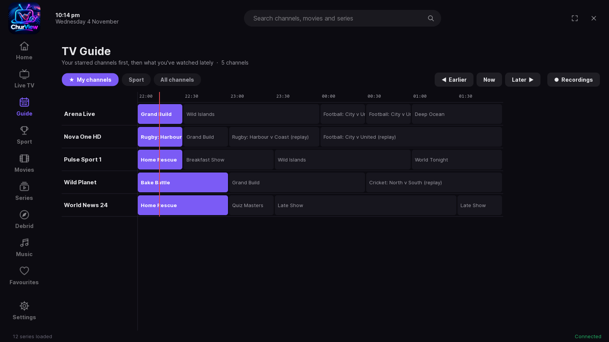
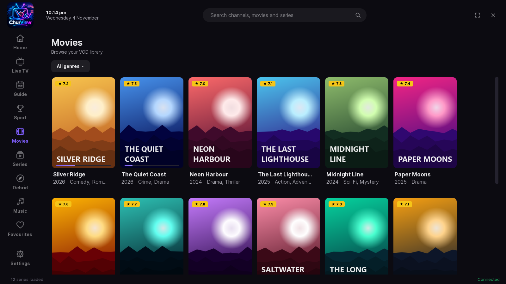
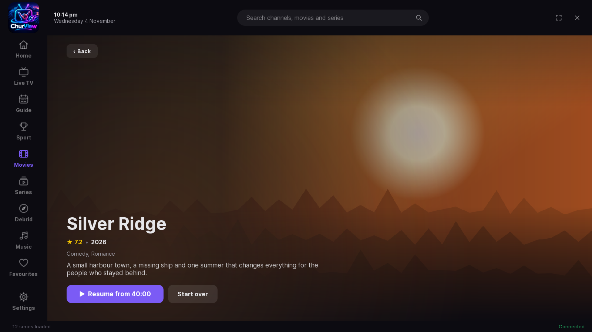

# ChurView for Android

**A good-looking, easy TV player for your own IPTV subscription, on your TV box, Android TV or phone.**
Live TV, a proper TV guide, films and series, all in one place, made to be used with a TV remote.

---

## What it does

**📺 Live TV that looks the part**
Every channel tile shows what's on now, how long is left and what's next. Each tile glows in the colour of its channel's logo.

**🗓️ A TV guide you'll actually use**
Your starred channels come first, followed by the ones you watch most. While watching, press **Right** or the remote's **Guide** button for a mini guide over the picture.

**🔁 Backup feeds, automatically**
If a channel stalls or keeps buffering, ChurView quietly switches to another copy of the same channel.

**🎬 Films and series**
Big posters, ratings and plots, and you pick up where you left off. Finish an episode and you're back on the episode list with the next one ready: just press OK.

**🎮 Made for the remote**
Everything works with the arrow keys and OK, with a clear glow showing where you are. Skip intro and recap, night mode and clear dialogue are all a button press away.

**🧩 Your add-ons, your accounts**
Optional Stremio add-on support and Trakt watch-history sync, using your own accounts.

**👨‍👩‍👧 Family friendly**
Follow a family member's favourite channels, and set a parental PIN.

---

## A look around

| Live TV | TV guide |
|---|---|
|  |  |
| **Films** | **Film page** |
|  |  |

*Screenshots use made-up demo channels and films. They're from the big-screen version, which the Android app matches.*

---

## Installing it

**On a TV box or Android TV**
1. Install the free **Downloader** app from the Play Store.
2. In Downloader, open `github.com/Palmer890/churview-android/releases/latest`.
3. Pick the `ChurView-x.x.x.apk` file and install it. If asked, allow Downloader to install apps.

**On a phone**
Open the [**latest release**](https://github.com/Palmer890/churview-android/releases/latest) on your phone, tap the `.apk` file and install it.

**Updates**
ChurView checks for new versions itself: see **Settings → Help & updates**. New versions go up as a **pre-release** first. Tick **Try new updates first** if you'd like them early.

---

## Private and secure

- **Your login stays yours.** ChurView talks to your provider over a secure (https) connection whenever the provider supports one.
- **Locked on the device.** Saved logins and keys are locked with Android's own secure key store, and left out of phone backups.
- **No tracking.** There are no adverts, no analytics and no accounts with us.

---

## Please note

ChurView is **a player only**. It comes with **no channels, films or subscriptions**: you sign in with your own provider, and you add your own add-ons if you want them. Only watch content you're allowed to watch.

Looking for the Windows and Linux version? It's at [**ChurView**](https://github.com/Palmer890/flux-media).

Made with ☕ by a Kiwi. **Chur!** 🤙

